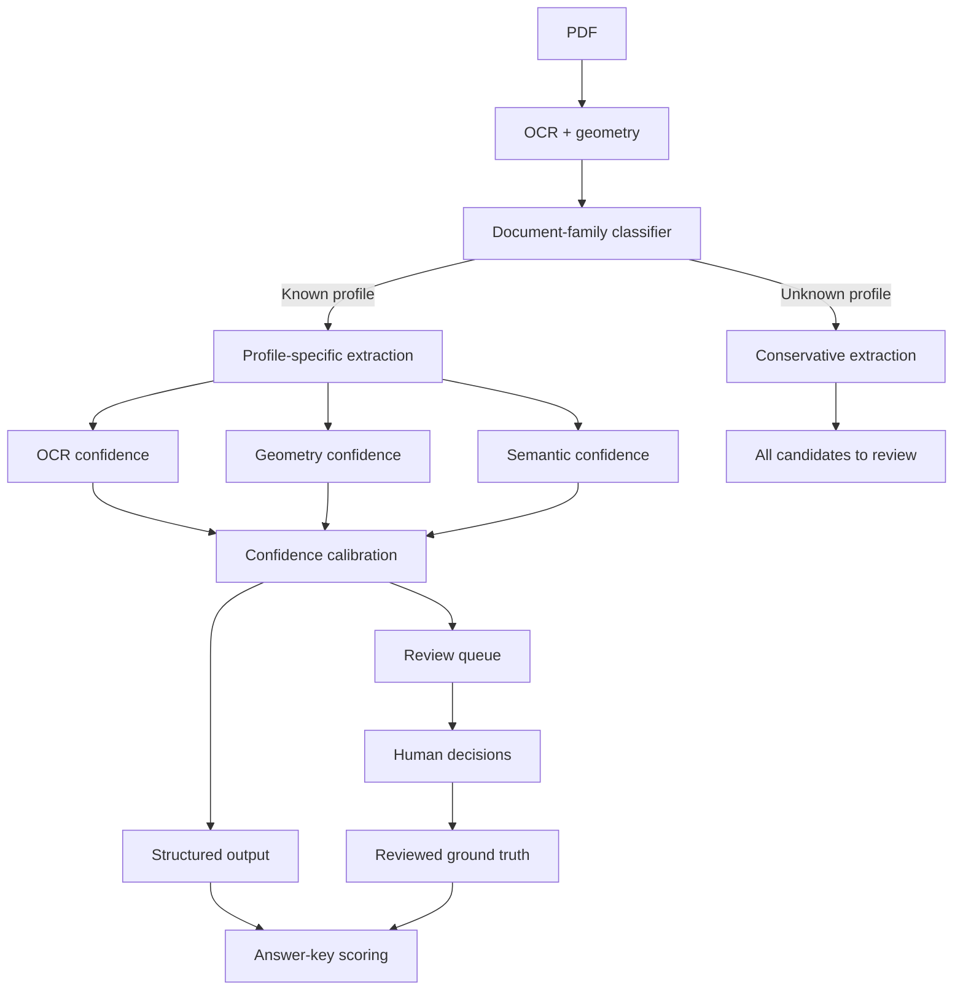

# Approach and findings

## Pipeline

I built one offline, evidence-preserving pipeline for both raster P&IDs and table-heavy engineering sheets. `pipeline.py` loads thresholds from `config/pipeline_config.json`, renders each PDF page at 360 DPI with Poppler, and divides it into overlapping 3x3 tiles. Apple Vision OCR is used on macOS, with Tesseract as a portable fallback. Every OCR result becomes an `OCRItem` containing text, confidence, alternatives, and normalized page coordinates; overlapping detections are then deduplicated.

The P&ID path combines OCR with geometry and spatial context. OCR evidence first selects an isolated tag grammar: `legacy_nuclear_pid` preserves the benchmark behavior, while `generic_isa_pid` supports five/six-digit ISA-style tags; the choice is configurable and can be overridden. A circle-and-divider detector finds PI/TI/PCV bubbles and checks leaders and adjacent pipe geometry for U-bends. Each bubble is OCR'd in original, autocontrast, and thresholded forms, with the final tag selected by vote. A separate six-edge detector finds continuation hexagons. Regexes and proximity rules normalize tags, join split bubble text, connect equipment names to identifiers, and reject equipment-like off-page references unless matching local context exists.

The table path detects repeated horizontal and vertical rules, reconstructs logical cells and merged headers, and excludes title/revision blocks. Each cell is enlarged into a contact sheet for OCR. Header semantics and within-table consistency correct common confusions such as `B/8`, `D/0`, sequential pump banks, paired drain valves, and monotonic instrument tags. The third sheet produces three substantive tables and currently scores 84/84 cells.

## Outputs and evaluation

`structured_output.json` is the answer-key-compatible result. `raw_ocr.json` preserves all text, coordinates, and detector evidence. `extraction_metadata.json` adds field-level confidence and source boxes; `review_queue.json` contains low-confidence, conflicting, or template-only reads. `tables.json` stores matrices, bounding boxes, and merged-cell metadata, while `tables/*.csv` provides directly inspectable tables. `score.py` reports category and micro precision/recall/F1; `score_tables.py` performs exact cell comparison. The `evaluation/answer_key_scope.json` manifest makes explicit that categories absent from a key are out of scope and that strict reference precision may not equal real-world precision when a key is incomplete. The extractor never reads evaluation files.

## Decisions, limitations, and next steps

Whole-page OCR found title blocks and notes but missed small tags; higher DPI alone did not solve minimum-text-size behavior, so overlapping tiles were materially better. The unseen strategy generalizes through visual primitives, coordinates, tag grammar, and context rather than known values; new drawing families add a profile without changing the validated legacy path. I rejected an API-only vision solution because it is less reproducible and harder to audit. Current failures include tiny text touching lines, rotation, borderless tables, and new symbol variants. With more time I would add synthetic degradation tests, deskew, a learned symbol detector trained from reviewed crops, and an HTML review UI.

The supplied key may be non-exhaustive: document 2 visually contains PCV2826-PCV2829 with the same treatment, while the key lists only PCV2828-PCV2829; document 1 visually contains PI2889 but omits it. My SME questions are: (1) are answer lists exhaustive, and what scope rule excludes visually identical tags? (2) should title/revision blocks count as tables, or only process-data tables?
